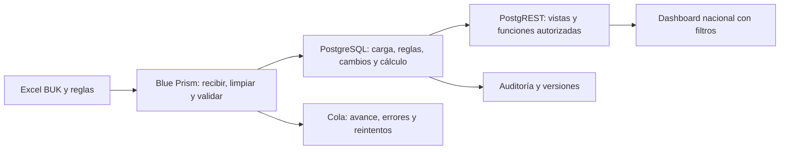

# PlanBot · Arquitectura para una lámina

## Texto de la lámina

**Blue Prism recibe y coordina.** Recibe el Excel, identifica el archivo por hash, limpia filas, valida con catálogos y registra errores. Orquesta la detección de cambios y el recálculo mediante funciones SQL, y entrega el resultado al operador a través de la cola y el registro de carga.

**PostgreSQL conserva y calcula.** Guarda las entradas, reglas versionadas y vigencias; detecta altas, bajas, cambios de jornada, cargo e instituto; calcula horas directas, indirectas, NAS, atenciones, meta y FOJA. Mantiene auditoría y publica vistas mediante PostgREST.

**El dashboard permite decidir.** Planificación central y jefaturas consultan una vista nacional y filtran por instituto, área, cargo, mes y profesional. Pueden revisar cambios, errores, cuadratura y, cuando se integre el flujo de escenarios, simular y aprobar parámetros.

## Un archivo de punta a punta

1. El operador termina de copiar un archivo y lo deja en `C:\PlanBot\entrada\buk`; las reglas entran por `entrada\planificacion` y P00.
2. P01 calcula SHA-256. Una huella ya procesada se informa como archivo repetido; una carga nueva obtiene carga_id en `stg.carga`.
3. P02 limpia la hoja, preserva el número de fila original y elimina columnas ajenas al contrato. Valida tipos, fechas, horas, institutos, cargos y duplicados; las filas rechazadas quedan en `stg.error_fila`, las válidas en `stg.buk_fila`.
4. Blue Prism llama `cargar_dotacion`, `detectar_cambios` y `mes_minimo_afectado` con el ID de carga. PostgreSQL normaliza y determina qué cambió y desde cuándo.
5. P04 llama `recalcular(desde_mes)`; el motor conserva los meses anteriores según el contrato y registra el motivo de los cambios auditables.
6. P05 informa estado y conteos, archiva el archivo según el release y permite al operador revisar errores. PostgREST publica el resultado; el dashboard consulta `api.v_kpi`, `api.v_cambios` y las demás vistas autorizadas.

No se trasladan las fórmulas asistenciales al robot ni al navegador. La separación permite corregir una regla y recalcular con la misma versión para todos los institutos. Las firmas, columnas y responsabilidades se conservan en [contratos.md](contratos.md).

## Cómo escala

Un mismo robot lógico puede atender archivos de todos los institutos porque IT forma parte de las claves y filtros. Para más volumen se agregan Digital Workers sobre las mismas colas compartidas, con adquisición exclusiva de cada ítem, sin asignar simultáneamente el mismo archivo a dos trabajadores. Evitar dos recálculos concurrentes sobre el mismo ámbito; la base/orquestador debe serializarlos o aplicar el mecanismo aprobado por Andrés.

La huella única identifica duplicados, pero no reemplaza la recuperación de una carga parcial: los lotes ODBC previos pueden haber quedado confirmados. Conciliar por carga_id antes de reintentar. Medir duración de carga, espera en cola y recálculo para dimensionar workers y licencias; no afirmar escalamiento ya probado.

Una nueva fuente, como SIC, reutiliza el patrón recibir → validar → staging → función SQL → vista. Requiere su propio mapeo, contrato y pruebas; no introducir columnas SIC en `stg.buk_fila`. El tablero puede incorporar después la comparación de atenciones realizadas y planificadas.

## Estado para presentar

Los Code stages y datos D-04 tienen pruebas locales. El release BP, las funciones SQL y las pantallas finales deben ensayarse juntos en la VM antes de presentar el flujo como demostrado. [progreso-codex.md](progreso-codex.md) registra lo verificado; la arquitectura describe la solución y el camino de escalamiento.
